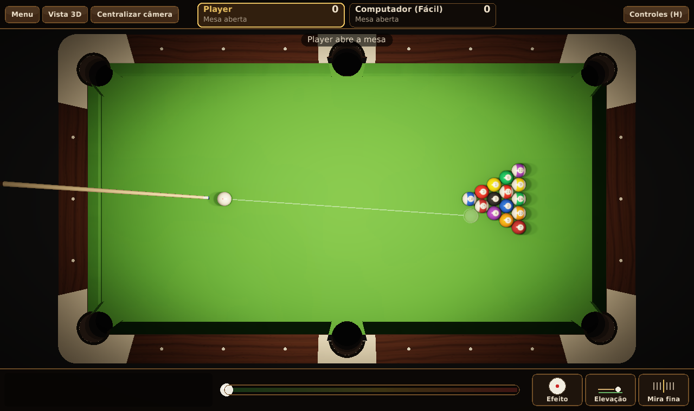
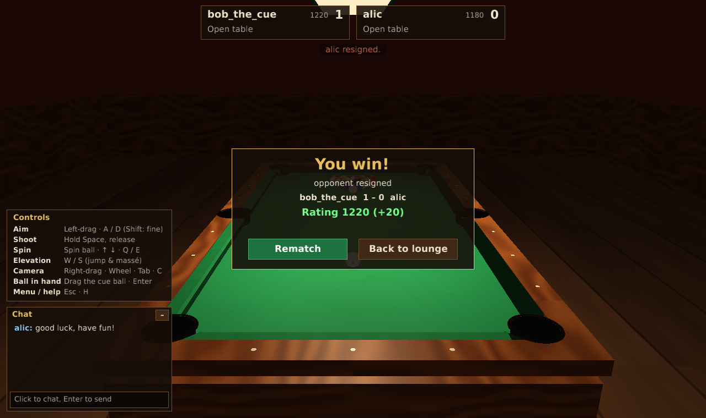

# Snook

A lightweight 3D eight-ball pool game for the desktop, written in Rust.

Snook is built around what made the old online pool rooms special: a realistic
cue (spin, draw, follow, jump and massé shots), a lounge where you meet people and
chat, invitations to play, and a global ranking that keeps everyone coming back.

| Top view | 3D view |
|---|---|
|  |  |

| Lounge | After an online game |
|---|---|
|  |  |

## Features

- **Real ball physics**: sliding → rolling transition, side spin (English) that
  changes cushion rebounds, draw and follow, squirt, throw, ball-to-ball friction,
  and balls that can leave the slate for **jump shots**.
- **Full cue control**: aim, power, the exact point where the tip hits the cue ball,
  and cue elevation.
- **Eight-ball rules** (WPA-based): break, open table, groups, fouls, ball in hand,
  called pocket for the 8.
- **Computer opponent** with three levels. It plays with the same physics and rules:
  it simulates candidate shots and scores the outcome. Harder levels plan cue-ball
  position, play safeties and aim more accurately.
- **Online lounge**: accounts (username + password), players online, lounge chat,
  invitations to **rated** or **casual** games, chat with the opponent during a match,
  rematches, a shot clock, reconnection after a dropped connection, and the
  **global leaderboard**.
- **Elo rating** (chess-style) with a higher K-factor for new players. Rated games
  show only a short aiming line; the full ghost-ball guide is for practice and
  casual games.
- **Graphics presets** (Low / Medium / High / Ultra; on the first run the game
  measures the frame rate and lowers the preset if needed). High and Ultra add
  soft shadows from every lamp and contact shading plus anti-aliasing (off, 2×,
  4×, 8×) and full screen, so it runs on old laptops and looks sharp on gaming PCs.
- **Small and fast**: a ~5 MB executable that runs on OpenGL 2.1 / GLES 2, so it works
  on practically any PC, including old integrated GPUs. Textures and sounds are
  generated at start-up; the only bundled files are the DejaVu fonts.

## Controls

Everything can be played with the mouse alone; the keyboard is optional.
The interface is available in English and Brazilian Portuguese (Settings → Game).

| Action | Mouse | Keyboard |
|---|---|---|
| Aim | drag on the table: the cue points at the mouse | A / D, ← / → (speeds up while held) |
| Fine aim | Shift + drag | Shift + A / D |
| Quick aim | click a ball or any spot on the cloth | |
| Shoot | drag the **Power** bar down, release | hold **Space**, release |
| Fine aim (mouse) | drag the dial in the cue panel, or hold ◀ ▶ | |
| Spin | click/drag on the spin ball | ↑ / ↓ (follow/draw), Q / E (English) |
| Cue elevation | elevation slider | W / S |
| Ball in hand | drag the cue ball | B toggles, Enter confirms |
| Call the 8-ball pocket | click a pocket on the table or on the little map (mandatory: the 8 in any other pocket loses) | |
| Camera | right-drag to orbit, wheel to zoom | Tab top view, C reset |
| Menu / controls help | **Menu** button | Esc / H |
| Full screen | | F11 |

Settings are saved in `%APPDATA%\Snook\settings.ini` (Windows),
`~/Library/Application Support/Snook` (macOS) or `~/.config/snook` (Linux).

## Building

Requires a recent stable Rust toolchain (see `rust-version` in `Cargo.toml`).

On Linux, install the system libraries for windowing and sound:

```bash
sudo apt-get install libasound2-dev libx11-dev libxi-dev libgl1-mesa-dev
```

Run the game:

```bash
cargo run --release -p snook
```

Run a local server and play online against yourself (start the game twice):

```bash
cargo run --release -p snook_server
```

The game connects to `ws://localhost:7878/ws` by default. To build a release that
points at your public server, set `SNOOK_SERVER` at build time (players can also
change it in Settings):

```bash
SNOOK_SERVER=wss://snook.example.com/ws cargo build --release -p snook
```

Putting the server on the internet is described in [docs/DEPLOY.md](docs/DEPLOY.md).

Useful flags (for development):

```bash
cargo run --release -p snook -- --vs hard        # straight into a game
cargo run --release -p snook -- --demo           # computer vs computer
cargo run --release -p snook -- --window 900x600 # start with this window size
cargo run --release -p snook -- --screenshot shot.png --frames 200
cargo run --release -p snook -- --demo --fps     # print frames per second
cargo run --release -p snook -- --online         # open the lounge directly
```

Run the tests:

```bash
cargo test --workspace --release
```

## Project layout

```
crates/
  core/     snook_core: physics, table geometry, 8-ball rules, AI, Elo rating
            (no engine dependencies; shared by the client and the server)
  proto/    snook_proto: the client/server messages (JSON over WebSocket)
  server/   snook_server: accounts, lounge, chat, invitations, authoritative
            matches, ratings and leaderboard (Axum + SQLite)
  client/   snook: the desktop client built on macroquad (3D scene with a
            custom lighting shader, input, HUD, sound, online screens)
vendor/
  miniquad/ miniquad with two platform fixes (see vendor/README.md)
```

Online games are **authoritative**: the client only sends the stroke (aim, power,
spin, elevation); the server simulates the shot with the same deterministic physics
and sends both players the resulting table, so nobody can cheat by editing their
client.

## Roadmap

1. ~~Physics, rules, AI, rating~~
2. ~~3D client with offline modes~~
3. ~~Game server: accounts, lounge with chat, invitations, authoritative matches~~
4. ~~Rated games and the global leaderboard~~
5. Installers for Windows, macOS and Linux; friends list; private rooms

## License

[MIT](LICENSE). The bundled DejaVu fonts keep their own license (below).

## Credits

Fonts: DejaVu Sans (Bitstream Vera license, see https://dejavu-fonts.github.io/License.html).
